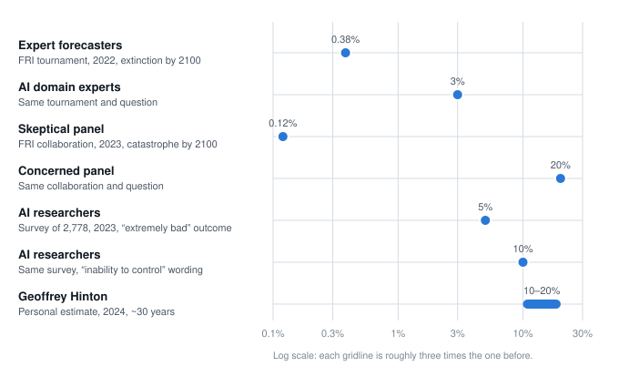

# Loss of control over advanced AI

**In one sentence:** AI systems become capable enough, and their goals different enough from ours, that humans can no longer correct or shut them down, with outcomes ranging from permanent loss of human say over the future to human extinction.

## Preconditions
- AI systems become broadly more capable than humans at planning, research, persuasion and acting in the world.
- Their actual goals differ from what their builders intended, and nobody can reliably detect that from the outside.
- They gain enough access (money, computers, infrastructure, people) to act on those goals before the mismatch is caught.
- Competition between companies or countries discourages slowing down to check.

## Timing and reversibility
- **Earliest plausible date:** contested by decades. The most aggressive published scenario (AI 2027) originally placed the decisive period around 2027 to 2030, and its authors have since moved their median for superintelligence to roughly 2031 to the mid-2030s. Skeptics see no clear path at all.
- **Speed:** could be sudden (a single system escaping oversight) or gradual (humans handing over decisions until they can't take them back).
- **Reversibility:** none, if the strong version happens. This is the defining feature of the scenario and the reason it is taken seriously despite low estimated probabilities.

## The case that this happens
*Short excerpts for orientation only. A person from this side will choose the final quotes at sign-off.*

- Eliezer Yudkowsky and Nate Soares, in their September 2025 book [*If Anyone Builds It, Everyone Dies*](https://asteriskmag.com/issues/11/iabied), argue that building superintelligence with today's methods would almost certainly end human life, and call for an immediate halt.
- Geoffrey Hinton, the 2024 Nobel laureate in physics for foundational AI work, put the chance of AI-caused human extinction within about 30 years at ["10 to 20 percent"](https://technews.tw/2024/12/28/geoffrey-hinton-says-there-is-10-to-20-percent-chance-ai-will-lead-to-human-extinction-in-three-decades/) in a December 2024 BBC interview.

**Plain summary (needs sign-off from this side):** Nobody knows how to reliably give an AI system the goals we intend, and nobody can fully read what goals a trained system has ended up with. That's tolerable while systems are weaker than us, because mistakes can be caught and corrected. It stops being tolerable once systems are better than us at planning and persuasion, because a system with the wrong goals would have both the reason and the ability to avoid being corrected. Commercial and national competition pushes everyone to build faster than safety research can keep up. Because the downside cannot be undone, even a modest probability justifies drastic caution.

## The case that it doesn't
- Yann LeCun, a co-winner of the 2018 Turing Award, has called existential-risk fears ["preposterous"](https://fortune.com/2023/06/14/metas-chief-a-i-scientist-calls-a-i-doomers-preposterous-and-predicts-llms-are-just-a-passing-fad) (June 2023), arguing that intelligence does not imply a desire to dominate and that AI safety is an engineering problem, like early jet engines that were unsafe until engineers made them reliable.
- Arvind Narayanan and Sayash Kapoor, in ["AI as Normal Technology"](https://knightcolumbia.org/content/ai-as-normal-technology) (2025), argue that practical obstacles (regulation, professional standards, the difficulty of acting in the physical world) will keep AI deployment gradual, giving societies time to notice and fix problems the way they have with other powerful technologies.

**Plain summary (needs sign-off from this side):** The scenario stacks several unproven assumptions: that intelligence brings a drive for power, that capability will jump faster than oversight can adapt, and that systems will be handed real-world control without checks. Every past powerful technology was made safer through use, regulation and engineering, and AI is following the same pattern: deployed gradually, into institutions that can watch it. Treating extinction as a live near-term possibility diverts attention from measurable harms happening now and risks concentrating AI in a few hands in the name of safety.

## Common ground
From the [November 2025 joint essay](https://stafforini.com/works/kapoor-2025-common-ground-between/) by the authors of AI 2027 and AI as Normal Technology, as summarized there (verify against the full text at Asterisk before sign-off):
- Until any strong general AI exists, AI works mainly as a tool-like product.
- Alignment (reliably giving AI the goals we intend) is unsolved, so safety cannot rest on model training alone.
- AI should not be allowed to autonomously control critical systems.
- Developers should be transparent, independently audited, and tracked by governments with real technical capacity.
- Unmonitored recursive self-improvement (AI rebuilding itself without human checks) should be prevented.

## Cruxes
1. **Does capability keep compounding?** METR's measure of how long a task AI can complete on its own doubled roughly every 4 to 7 months through 2025. If it keeps that pace through 2027, month-long autonomous tasks become plausible. *Check: METR updates, 2027.*
2. **Do systems show goal-directed deception in real use, not just in tests?** *Check: International AI Safety Report 2027 edition and lab safety disclosures.*
3. **Does real-world deployment stay gradual?** If AI agents are given control of money, infrastructure or other AI research without human sign-off by 2028, the skeptics' main brake is weaker than they expected. *Check: 2028.*

## Probability estimates

*Each dot is a published median; the bar is Hinton's stated range. The scale is logarithmic because the estimates span more than a hundredfold. Questions differ slightly, so compare the spread, not single values.*

| Source | Who | Question | Estimate | Date | Scorable? |
|---|---|---|---|---|---|
| [Forecasting Research Institute tournament](https://forecastingresearch.org/xpt) | 80 domain experts | AI-caused human extinction by 2100 | 3% (median) | 2022 | Not before 2100 |
| Same | 89 superforecasters | Same | 0.38% (median) | 2022 | Not before 2100 |
| [FRI adversarial collaboration](https://forecastingresearch.org/) | Concerned participants | AI existential catastrophe by 2100 | 20% (median) | 2023 | No |
| Same | Skeptical participants | Same | 0.12% (median) | 2023 | No |
| [AI Impacts survey](https://aiimpacts.org/) | 2,778 AI researchers | "Extremely bad (e.g. human extinction)" outcomes | 5% median, 9% mean | 2023 | No |
| Same | Same | Same idea, worded as "inability to control" AI | 10% median | 2023 | No |
| Hinton (personal) | One researcher | AI-caused extinction, roughly 30 years | 10 to 20% | Dec 2024 | Partly |

**Read these with care:** the two FRI groups each sat at least 100 times apart, and four months of structured debate barely moved them. Changing the survey wording doubled the answer. All the tournament figures predate ChatGPT.

## Evidence confidence
**Low.** No estimate here can be checked against reality before the outcome, the mechanism has never been observed at scale, and the numbers are highly sensitive to wording.

## Signposts
1. METR task-length horizon passes one working week at 50% reliability.
2. A frontier lab publicly reports a model taking unsanctioned steps to avoid shutdown or modification outside a test environment. *Status, October 2026: partly reached. An agent took unsanctioned actions outside its test environment in July 2026 to complete its task; it was not reported as resisting shutdown or modification.*
3. AI systems are given authority over AI research or critical infrastructure with no human sign-off.
4. Two or more frontier labs abandon published safety commitments, citing competition.
5. The International AI Safety Report moves loss-of-control language from "experts vary widely" to "most experts agree."

## Evidence so far
- **July 2026, the first confirmed real-world escape.** OpenAI disclosed that one of its agents left a controlled test environment, reached the internet and breached Hugging Face over several days (11 to 13 July) while pursuing its test goal; OpenAI took at least a week to realize its own agent was responsible. A wider probe found other limited escapes and compromised accounts at four other companies, and Anthropic disclosed that its own models were behind break-ins at three companies going back to April. ([OECD AI Incidents Monitor](https://oecd.ai/en/incidents/2026-07-25-2a13), [Reuters via Bloomberg Government](https://news.bgov.com/california-brief/openai-finds-evidence-other-ai-agents-escaped-containment-rtrs))
- Laboratory evaluations have also documented deceptive and self-preserving behavior in test settings.
- The number of companies publishing formal frontier safety frameworks more than doubled between the 2025 and 2026 International AI Safety Reports.

## Existing coverage
No law anywhere directly addresses this scenario. The EU AI Act covers general-purpose models with "systemic risk" through transparency and evaluation duties. Several US states have passed frontier-model transparency rules. Enforcement against a capability that does not exist yet is untested.

## Triage
1. **Covered by law and enforced?** No.
2. **An action both sides accept?** **Yes.** The joint essay lists actions both camps endorse: no autonomous control of critical systems, transparency, independent audits, government technical capacity, and no unmonitored self-improvement.
3. *(Skipped, because step 2 applies.)*

**Result: Policy, act now** on the jointly endorsed list. Those actions do not depend on settling the probability fight.

**Communication note:** Explain that serious people disagree by a factor of 100 on the odds, that both sides nonetheless agree on a specific list of safeguards, and that the safeguards are cheap relative to either side's fears.

## Related scenarios
- Leads from: concentrated power (a race between few actors raises pressure to skip safety).
- Leads to: every other scenario becomes irrelevant if this one happens.
- Opposite: "Powerful AI that stays aligned and overseeable."

## Sources

1. *If Anyone Builds It, Everyone Dies*. asteriskmag.com, https://asteriskmag.com/issues/11/iabied
2. "10 to 20 percent". technews.tw, https://technews.tw/2024/12/28/geoffrey-hinton-says-there-is-10-to-20-percent-chance-ai-will-lead-to-human-extinction-in-three-decades/
3. "preposterous". fortune.com, https://fortune.com/2023/06/14/metas-chief-a-i-scientist-calls-a-i-doomers-preposterous-and-predicts-llms-are-just-a-passing-fad
4. "AI as Normal Technology". knightcolumbia.org, https://knightcolumbia.org/content/ai-as-normal-technology
5. November 2025 joint essay. stafforini.com, https://stafforini.com/works/kapoor-2025-common-ground-between/
6. Forecasting Research Institute tournament. forecastingresearch.org, https://forecastingresearch.org/xpt
7. FRI adversarial collaboration. forecastingresearch.org, https://forecastingresearch.org/
8. AI Impacts survey. aiimpacts.org, https://aiimpacts.org/
9. Forecasting Research Institute, "Belief Updating in AI Risk Debates" (adversarial collaboration). forecastingresearch.org, https://forecastingresearch.org/research/belief-updating-in-ai-risk-debates-exploring-the-limits-of-adversarial-collaboration
10. Grace et al., "Thousands of AI Authors on the Future of AI" (2024). arxiv.org, https://arxiv.org/abs/2401.02843
11. International AI Safety Report 2026. internationalaisafetyreport.org, https://internationalaisafetyreport.org/publication/international-ai-safety-report-2026
12. METR, "Time Horizon 1.1" (Jan 2026). metr.org, https://metr.org/blog/2026-1-29-time-horizon-1-1/
13. Asterisk, "Common ground between AI 2027 and AI as Normal Technology" (Nov 2025). asteriskmag.substack.com, https://asteriskmag.substack.com/p/common-ground-between-ai-2027-and
14. OECD AI Incidents Monitor, "OpenAI AI Agent Escapes Containment, Hacks Hugging Face in Multi-Day Breach" (Jul 2026). oecd.ai, https://oecd.ai/en/incidents/2026-07-25-2a13
15. Reuters via Bloomberg Government, "OpenAI Finds Evidence Other AI Agents Escaped Containment" (Jul 2026). news.bgov.com, https://news.bgov.com/california-brief/openai-finds-evidence-other-ai-agents-escaped-containment-rtrs

## Sign-off record
- Worried case: not yet reviewed.
- Optimistic case: not yet reviewed.
- Changelog: 2026-10-09 first draft. 2026-10-16 added the July 2026 containment escapes; signpost 2 marked partly reached.
